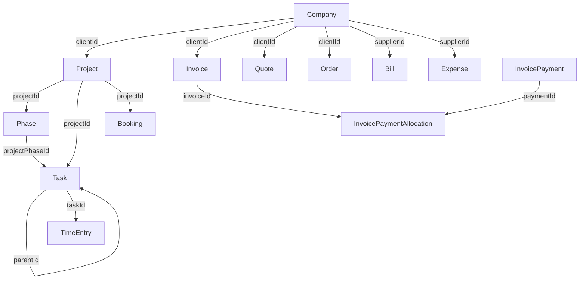

# Data Model

## Table of contents
- Object overview
- Relationships
- Creation order
- Status rules
- Traps to avoid

## Object overview

| Object | Key fields | Notes |
|---|---|---|
| Company | `companyName`, `id` | Can be a client, supplier, or both |
| Person | `firstName`, `id`, `relatedCompanyIds` | Must be linked to at least one company |
| Project | `name`, `companyId`, `id` | Requires a company |
| Project phase | `name`, `projectId`, `id` | Lives under a project |
| Task | `name`, `projectId`, `projectPhaseId`, `parentId`, `id` | `parentId` makes it a subtask |
| Time entry | `taskId`, `duration`, `userId`, `id` | Must be created under a task |
| Invoice | `clientId`, `date`, `id` | `clientId` is a company ID |
| Invoice payment | `invoiceId`, `sum`, `id` | Links payment to one or more invoices via allocations |
| Invoice payment allocation | `paymentId`, `invoiceId`, `sum` | Allocates a payment across invoices |
| Quote | `clientId`, `date`, `id` | Sales pipeline document |
| Order | `clientId`, `date`, `id` | Confirmed quote |
| Bill | `supplierId`, `date`, `id` | Supplier-side invoice |
| Expense | `supplierId`, `date`, `id` | Operational cost |
| Booking | `projectId`, `userId` or `roleId`, `startDate`, `endDate`, `amount`, `amountType` | Capacity reservation |

## Relationships



## Creation order

Follow these sequences — creating out of order results in a 400 or 422 error.

**Client → logged time:**
1. `POST /companies` — create the client company (note the returned `id`)
2. `POST /projects` with `companyId` — create a project under the company
3. `POST /tasks` with `projectId` — create a task under the project
4. `POST /tasks/{taskId}/time-entries` — log time under the task

**Client → invoice payment:**
1. `POST /companies` — create or find the client company
2. `POST /invoices` with `clientId` — create the invoice
3. `POST /invoices/{id}/lines` — add line items
4. `POST /invoice-payments` with `sum` and `paymentAccountId`
5. `POST /invoice-payment-allocations` with `paymentId` and `invoiceId`

**Supplier → bill payment:**
1. `POST /companies` — create or find the supplier company
2. `POST /bills` with `supplierId` and `date`
3. `POST /bills/{id}/lines` — add line items
4. `POST /bill-payments` — record the payment

## Status rules

**Site-defined statuses** — used by projects, tasks, quotes, orders, and purchase orders:
- Read available statuses from `GET /statuses` filtered by module.
- The `status` field on these objects takes the `code` string (e.g. `"active"`, `"won"`, `"todo"`) — never the numeric `id`.
- Status codes are site-specific and vary between Scoro installations.

```http
# Read available task statuses
GET /statuses?filters[entityType]=task
```

**Fixed statuses** — used by invoices, bills, and expenses:
- `"paid"` — payment received/sent in full
- `"unpaid"` — outstanding
- `"voided"` — cancelled, excluded from reporting

## Traps to avoid

- **Quote → Order → Invoice links are read-only.** These relationships appear in API responses but cannot be set in request bodies. There is no "convert quote to invoice" endpoint. Documents created by an agent will not appear linked in the Scoro UI the way natively-created documents do.
- **`relatedCompanyIds` on a person replaces the entire array.** On `PATCH /persons/{id}`, sending `"relatedCompanyIds": [5]` removes all other company associations and leaves only company 5. Always read the current value and include all IDs you want to keep.
- **Custom fields differ per Scoro site.** Always read field definitions from `GET /{module}/custom-fields` before writing. Send custom fields as a flat map keyed by field name: `{"c_myField": "value"}` — not as an array of `{id, value}` objects.
- **Tags on custom module entities replace the full set** on update — same behavior as `relatedCompanyIds`.
- **Projects require `companyId`.** A project cannot exist without a client company. Create or find the company first.
- **Time entries require a task.** There is no way to log time directly to a project or company — a task must exist first.
