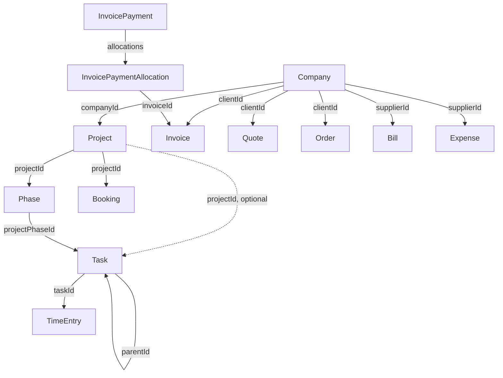

# Data Model

## Table of contents
- Object overview
- Relationships
- Creation order
- Status rules
- Traps to avoid

## Object overview

| Object | Key fields | Notes |
|---|---|---|
| Company | `companyName`, `id`, `isClient`, `isSupplier` | The same record can be a client, a supplier, or both |
| Person | `firstName`, `id`, `relatedCompanyIds` | Company links are optional |
| Project | `name`, `companyId`, `id` | Requires a company |
| Project phase | `title`, `type`, `projectId`, `id` | Lives under a project; `type` is `"phase"` or `"milestone"` |
| Task | `name`, `projectId`, `projectPhaseId`, `parentId`, `id` | Only `name` is required; `parentId` makes it a subtask |
| Time entry | `duration`, `startDateTime`, `userId`, `id` | Created under a task; only `duration` is required |
| Invoice | `clientId`, `date`, `id` | `clientId` is a company ID |
| Invoice payment | `amount`, `clientId`, `paymentAccountId`, `id` | Money received; linked to invoices through allocations |
| Invoice payment allocation | `amount`, `invoiceId` or `prepaymentId` | Created under a payment: `POST /invoice-payments/{id}/allocations` |
| Quote | `clientId`, `date`, `id` | Sales pipeline document |
| Order | `clientId`, `date`, `id` | Confirmed quote |
| Bill | `supplierId`, `date`, `id` | Supplier-side invoice |
| Expense | `supplierId`, `date`, `id` | Operational cost |
| Booking | `projectId`, `userId` or `roleProjectId`, `startDate`, `endDate`, `amount`, `amountType` | Capacity reservation; `amount` is in seconds |

## Relationships



## Creation order

Follow these sequences — referencing a parent that doesn't exist results in a `400`, or a `404 RelatedResourceNotFoundException`.

**Client → logged time:**
1. `POST /companies` — create the client company (note the returned `id`)
2. `POST /projects` with `name` and `companyId` — create a project under the company
3. `POST /tasks` with `name` and `projectId` — create a task under the project (a task without a project is also valid)
4. `POST /tasks/{taskId}/time-entries` with `duration` — log time under the task

**Client → invoice payment:**
1. `POST /companies` — create or find the client company
2. `POST /invoices` with `clientId`, `date` and `lines` — create the invoice with its lines in one call
3. `POST /invoices/{invoiceId}/payments` with `amount` — record and allocate a payment in one call

To split one payment across several invoices, create it with `POST /invoice-payments` and then allocate with `POST /invoice-payments/{id}/allocations` per invoice. See `references/finance.md`.

**Supplier → bill payment:**
1. `POST /companies` — create or find the supplier company
2. `POST /bills` with `supplierId`, `date` and `lines`
3. `POST /bill-payments` with `amount`, `billId` and `paymentAccountId` — or `POST /bills/{id}/mark-paid` to settle the whole balance

## Status rules

**Site-defined statuses** — used by projects, tasks, quotes, orders, and purchase orders:
- Read available statuses from `GET /statuses` filtered by module.
- The `status` field on these objects takes the `code` string (e.g. `"active"`, `"won"`, `"todo"`) — never the numeric `id`.
- Status codes are site-specific and vary between Scoro installations.

```http
# Read available task statuses
GET /statuses?filters[modules][]=tasks
```

Module names are `projects`, `tasks`, `quotes`, `orders` and `purchaseOrders`. Each status returns `code`, `module`, `name`, `isModuleDefault` and, for quotes, `probability`.

**Fixed statuses** — used by invoices, prepayments, bills, and expenses:
- `"paid"` — payment received/sent in full
- `"unpaid"` — outstanding
- `"voided"` — cancelled, excluded from reporting

## Traps to avoid

- **Quote → Order → Invoice links are mostly read-only.** Invoices, orders and quotes return `quoteIds`, `orderIds` and `prepaymentIds`, but their create and update requests have no link fields, and there is no "convert quote to invoice" endpoint. The exceptions: a bill accepts `purchaseOrderId` and `quoteId`, bill and expense lines accept `quoteLineId`, and bill lines accept `invoiceLineId`.
- **`relatedCompanyIds` on a person replaces the entire array.** On `PATCH /persons/{id}`, sending `"relatedCompanyIds": [5]` removes all other company associations and leaves only company 5. Always read the current value and include all IDs you want to keep.
- **Custom fields differ per Scoro site.** Always read field definitions from `GET /{module}/custom-fields` before writing. Send them inside a `customFields` object keyed by the field `id` (a `c_...` name): `{"customFields": {"c_region": "north"}}` — not as top-level keys and not as an array of `{id, value}` objects.
- **Tags on custom module entities replace the full set** on update — same behavior as `relatedCompanyIds`.
- **Projects require `companyId`.** A project cannot exist without a client company. Create or find the company first.
- **Time entries require a task.** The only create endpoint is `POST /tasks/{taskId}/time-entries` — there is no way to log time directly to a project or company.
